# TL;DR · Conversational AI Design Framework

The short version of the framework in five sections. Each takes about six minutes, so the whole page fits a 30-minute talk. Every section has one key message, the main points, the techniques to use, and a diagram or chart you can scan.

> **In one sentence:** seven phases that help Product, Design, Development and Data Science build conversational AI that solves a real problem, gives correct answers and fails safely.

| # | Section | Phases | Key message | Time |
| --- | --- | --- | --- | --- |
| 1 | The big idea | All | Start from the user's problem, not from what the model can do. | ~6 min |
| 2 | The journey | 1–7 | Seven phases, four roles, one canvas, a checklist at the end of each phase. | ~6 min |
| 3 | Shape it | 1 Discover · 2 Define | Prove the problem is real, then draw clear limits around what the AI does. | ~6 min |
| 4 | Design the conversation | 3 Model · 4 Design | Design the loop and every way it can go wrong, then write how the AI behaves. | ~6 min |
| 5 | Prove it and keep learning | 5 Validate · 6 Deliver · 7 Learn | Test the answers, not just the screens, and keep testing after launch. | ~6 min |

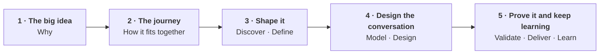

---

## 1. The big idea

**Key message:** conversational AI fails in new ways. It can sound confident and still be wrong. This framework gives the team one shared way to build it so it solves a real problem, gives correct answers and fails safely.

### Main points

- **Not every problem needs a chat window.** If a button or a filter does the job better, build the button.
- **Correct beats fluent.** A confident wrong answer is worse than no answer.
- **Design the behavior, not only the screens.** How the AI talks, what it refuses and how it recovers is design work.
- **Stopping early is a good result.** If a normal screen solves the problem, the framework did its job.

### Six principles, in priority order

When two good options conflict, the higher one wins.

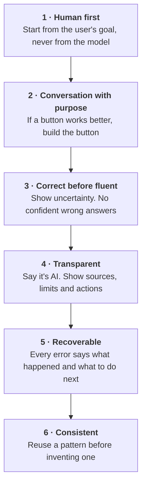

### Four rules for every product

| Rule | What it means |
| --- | --- |
| **Say it's AI** | Users must know they're talking to an AI. The EU AI Act has required this since August 2026. |
| **Show sources** | Every factual claim points to where it came from. |
| **Agree privacy and logging** | What's logged, for how long, and who can read it. |
| **Evaluate before every release** | Run every test case three times. Zero critical failures. |

### Technique: the running example

One product goes through every phase: a **KPI investigation assistant**. It helps product managers find and explain unusual KPI changes without opening several dashboards. Use it to make each section concrete.

> **Say it in one line:** start from the problem, be honest about what the AI knows, and never leave the user stuck.

---

## 2. The journey

**Key message:** seven phases in order, each with a short checklist at the end (the *exit gate*). Four roles share the work. One canvas holds every decision.

### Seven phases, two loops

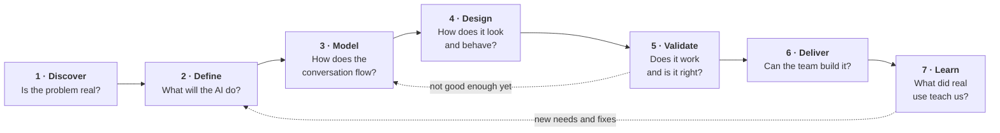

- **Loop 1: Model → Design → Validate** repeats until the answers are good enough to ship.
- **Loop 2: Learn → Define** brings what you learn after launch into the next version.
- **Every exit gate has three outcomes:** pass, go back, or stop.

### Four roles, four questions

When roles disagree, the owner of that question decides.

| Role | The question they own | Decides |
| --- | --- | --- |
| **Product owner** | Is this worth building, and is it working? | Go or no-go at each gate. Scope. When to switch the AI off. |
| **Design** | Does it make sense to the user? | How the AI talks, which patterns are used, how errors look to the user. |
| **Development** | Does it run safely and reliably? | How it's built, which model version runs in production. |
| **Data Science** | Are the AI's answers good enough? | Whether the AI meets the quality bar, which model and prompt setup. |

### Who leads each phase

● leads · ◐ contributes · ○ reviews

| Phase | Product owner | Design | Development | Data Science |
| --- | :---: | :---: | :---: | :---: |
| 1. Discover | ● | ◐ | ○ | ◐ |
| 2. Define | ● | ◐ | ◐ | ◐ |
| 3. Model | ○ | ● | ◐ | ◐ |
| 4. Design | ○ | ● | ◐ | ◐ |
| 5. Validate | ○ | ● | ◐ | ● |
| 6. Deliver | ○ | ◐ | ● | ◐ |
| 7. Learn | ● | ◐ | ◐ | ◐ |

**For designers:** Design leads three of the seven phases (Model, Design, Validate) and contributes to the rest.

### One canvas: the AI Use Case Canvas

The team fills one canvas as it goes. Each phase fills its own rows. It has 14 rows in total.

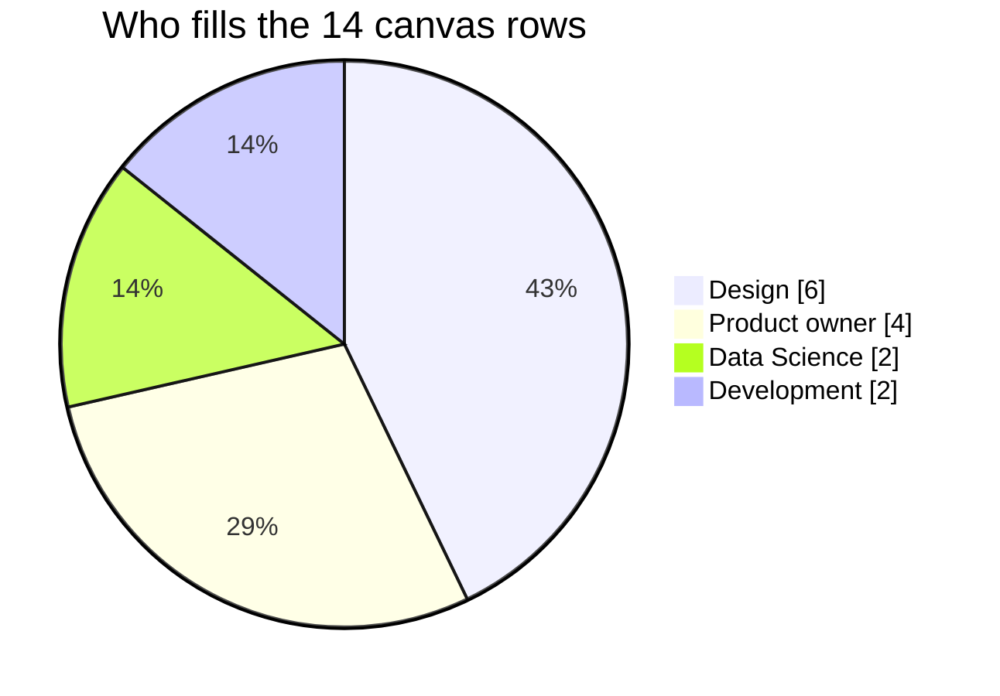

> **Say it in one line:** follow the phases, know your role, fill the canvas, pass the gate.

---

## 3. Shape it

**Phases 1–2 · Discover and Define**

**Key message:** prove the problem is real and that conversation is the right answer before anyone designs a chat window. Then agree exactly what the AI can do, can't do and must confirm first.

### Main points

- Talk to real users and **measure how they solve the problem today** (the baseline).
- **Check the data first.** AI can't fix bad data. No approved data with a named owner means no product.
- **Choose the interaction model on purpose.** Most strong enterprise products are hybrid.
- **No open-ended "Ask AI anything".** Every capability has a named data source or tool.

### Technique 1: choose the interaction model

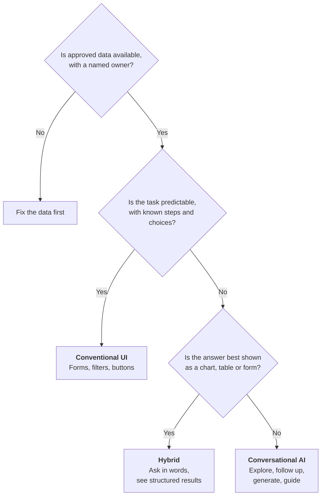

### Technique 2: the capability chain

Write one chain per capability. If you can't name the data or tool, the capability isn't ready.

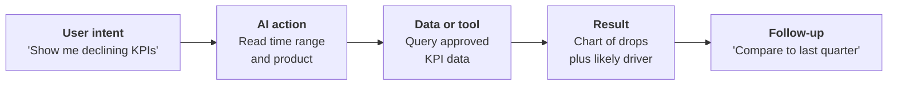

### Technique 3: three zones

Every request falls into one of three zones.

| ✅ Can do | ⚠️ Must confirm first | ⛔ Can't do |
| --- | --- | --- |
| Find, explain, summarize, compare | Send, submit, publish, approve | Show data the user isn't allowed to see |
| Generate, transform, recommend | Delete or significantly change content | Act outside the agreed capability list |
| Run approved low-risk actions | Anything that can't be undone | Make claims without a source |
| → Answer, with sources | → Show a preview, wait for the user's OK | → Explain the limit, offer an alternative |

### Technique 4: three extra-check questions

Some rules apply only when the product needs them. Answer three questions in Define.

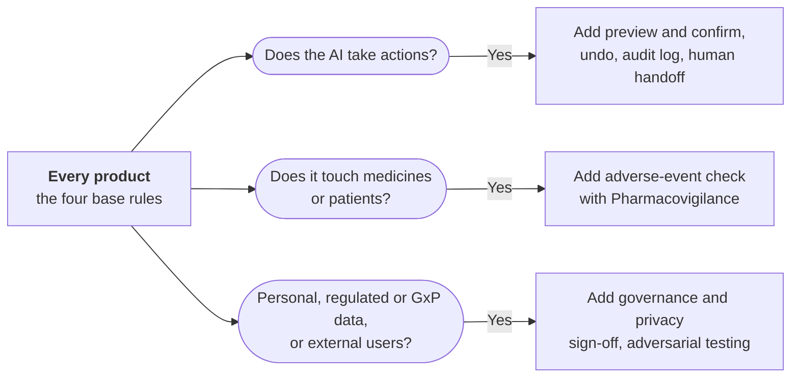

### Technique 5: set success metrics against the baseline

Pick two to four metrics, each with a target: task success, time to answer, answer accuracy, rephrase rate, give-up rate, trust calibration. Also set a response-time target (for example, streaming starts within 2 seconds).

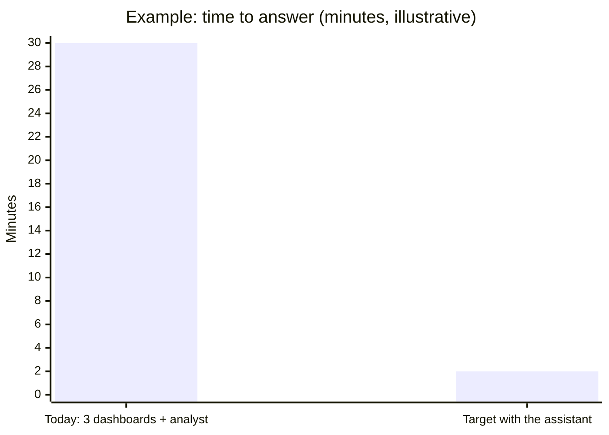

> **Say it in one line:** prove the need, check the data, and draw the limits before you design anything.

---

## 4. Design the conversation

**Phases 3–4 · Model and Design**

**Key message:** a conversation is a loop of turns, not a fixed sequence of screens. Design what happens when it goes wrong, build from reusable patterns, and write the behavior spec that tells the AI how to act.

### Main points

- **Design the unhappy paths as carefully as the happy path.** Every failure needs a written response.
- **Show what the AI remembers.** Users assume it remembers more than it does.
- **Reuse patterns** from the Pattern Catalogue before inventing new ones.
- **The behavior spec is design work.** Design owns what it says. Data Science turns it into a working prompt.
- **Prototype with the real model early.** Five real questions teach more than a polished Figma flow.

### Technique 1: the conversation loop

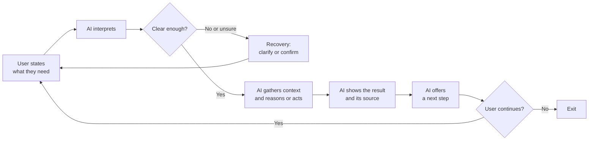

### Technique 2: design every way it can go wrong

| When this happens | The AI should | Example (KPI assistant) |
| --- | --- | --- |
| Information is missing | Ask only for what it needs | — |
| The request is ambiguous | Offer two or three clear options | "How are we doing?" → "Active users, conversion or revenue?" |
| It isn't sure what the user meant | Say what it understood and ask to confirm | "I read this as 30-day retention, last quarter. Is that right?" |
| Nothing is found | Say what it searched, suggest a change | — |
| Only part is found | Show what it found, name what's missing | — |
| Out of scope | Explain the limit, offer an alternative | "I only have internal KPIs. I can compare with internal benchmarks." |
| The system fails | Say what happened and how to recover | — |
| A multi-step action fails partway | Stop, show what was and wasn't done, offer retry, undo or a person | — |
| A person is needed | Hand off with the conversation history | — |

### Technique 3: build from patterns, in the order they appear

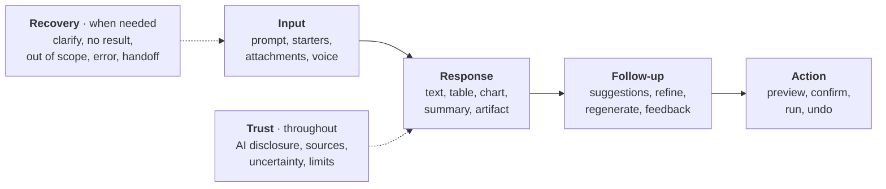

- **Every product includes:** AI disclosure, prompt starters, sources, uncertainty, clarification, out of scope, error and retry, feedback.
- **If the AI takes actions, add:** preview and confirm, undo or cancel, human handoff.

### Technique 4: write the behavior spec

The behavior spec is the brief the AI follows (in practice, the system prompt). It has five parts and is versioned next to the code.

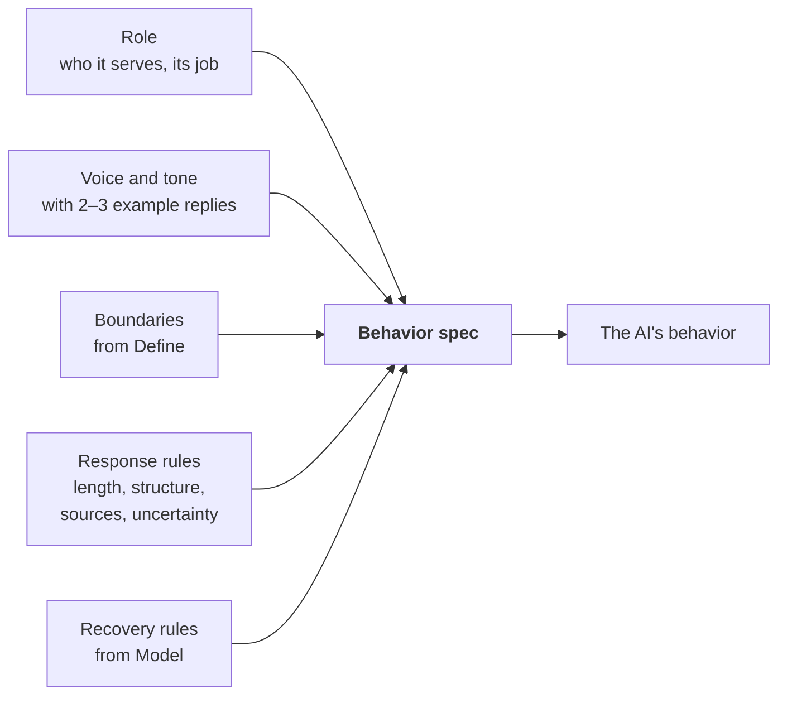

### Also design

- **First run:** three to five prompt starters, plus one key limit stated up front.
- **Accessibility:** screen readers announce new messages and streaming; keyboard and zoom work; every chart has a text summary.
- **Language:** say which languages are supported on first run.

> **Say it in one line:** design the loop and the failures, reuse patterns, and write down how the AI should behave.

---

## 5. Prove it and keep learning

**Phases 5–7 · Validate, Deliver and Learn**

**Key message:** prove two things: users can say what they need, and the AI's answers are correct. Most teams test only the first. Then hand over behavior, not just screens, and keep testing after launch.

### Main points

- **Two tracks, one decision.** User testing (Design) and answer quality (Data Science) feed one go/no-go call.
- **One good run proves nothing.** The same question can get different answers, so run every test three times.
- **Hand over one package.** Flow, patterns, copy, behavior spec, prompt and test set go to Development together.
- **Any change means re-testing.** A new model, behavior spec or data source means the evaluation runs again.
- **Real use feeds the next version.** Review monthly (weekly in month one).

### Technique 1: two tracks of testing

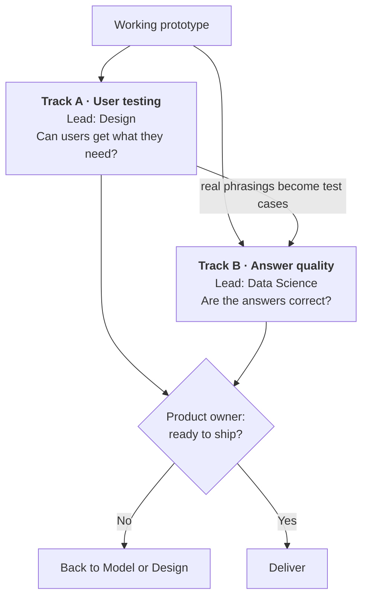

**Track A tip for designers:** give participants a goal, not a prompt (*"You want to understand why KPI X declined"*). Include two or three deliberately wrong answers and watch who questions them.

### Technique 2: four checks, three runs

A test case passes only if every one of three runs passes all four checks.

| Check | Passes when |
| --- | --- |
| **Correct** | Facts and numbers are right. |
| **Grounded** | Every claim traces to an approved source, and the source is shown. |
| **Honest** | Uncertainty is stated. No invented causes or figures. |
| **In bounds** | It stays inside the three zones and follows the behavior spec. |

Build 5 to 10 test cases per capability. Cover clear, vague, multi-part and out-of-scope requests, follow-ups, restricted data, prompt injection and each supported language.

### Technique 3: the ship decision

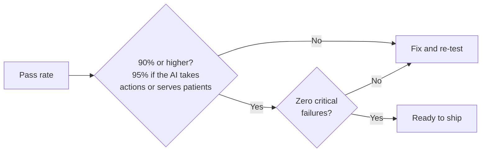

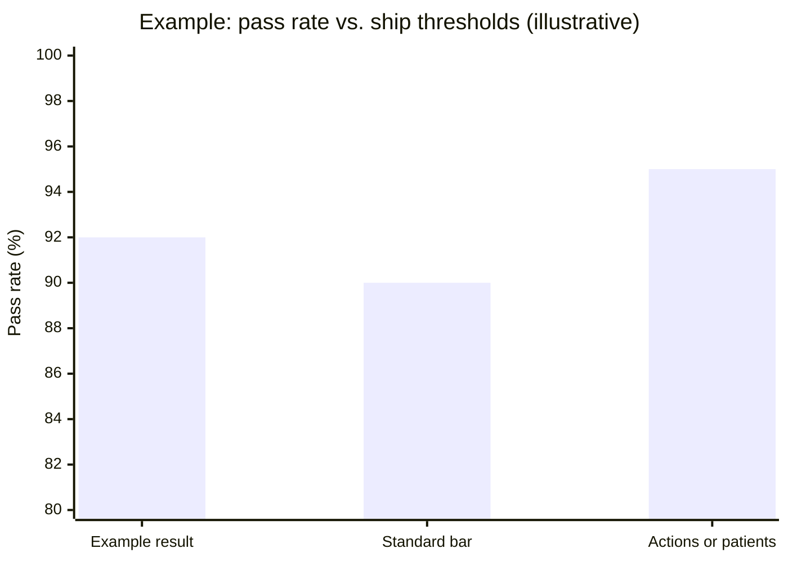

**A critical failure** is any of these: a wrong number presented as fact; a cause presented as fact when the data doesn't support it; an action taken without confirmation; restricted data shown to the wrong user.

### Technique 4: the handoff package

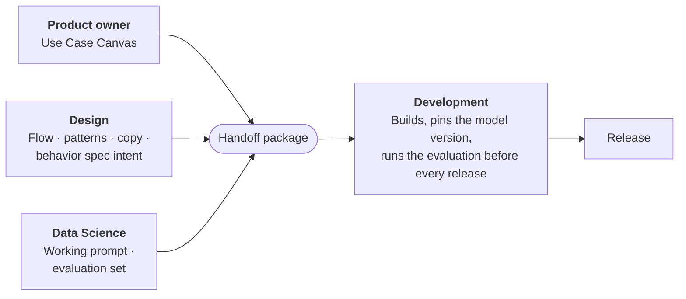

### Technique 5: the learning loop

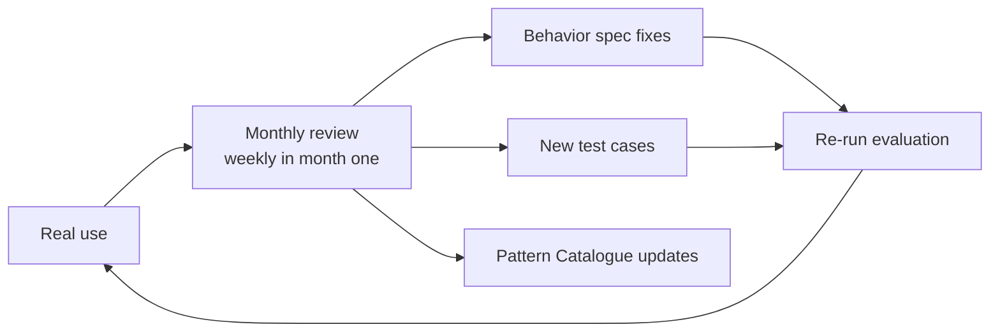

**Act right away when:** a critical failure shows up in production (pause the capability); a metric misses its target two reviews in a row (go back to Define or Design); a data source or the model changes (re-run the evaluation).

> **Say it in one line:** test the answers three times, hand over behavior, and let real use improve the next version.

---

## Five things to remember

1. **Problem first.** If a button works better, build the button.
2. **Draw the limits.** Can do, must confirm, can't do.
3. **Design the failures.** Every way it can go wrong gets a written response.
4. **Test the answers.** Four checks, three runs, zero critical failures.
5. **Keep learning.** Any change means re-testing; real use shapes the next version.

## Questions to bring to your next design critique

- Is conversation the right choice, or would hybrid or a normal screen work better?
- Can users tell what the AI can and can't do?
- Does every error give a clear next step?
- Are sources and uncertainty visible?
- Are actions previewed and confirmed?
- Could an existing pattern solve this?

---

## Notes for building the TL;DR page

- **Navigation:** add "TL;DR" to the top bar. It opens the five sections above, in order, with a step indicator (1–5) and about 6 minutes per section.
- **Layout per section:** kicker (phases covered), title, key message, then main points on the left and the diagram or chart on the right. End with the "Say it in one line" takeaway.
- **Links:** each section links to the full chapters it summarizes (section 1 → Principles and Rules; 2 → Lifecycle and Roles; 3 → Phases 1–2; 4 → Phases 3–4; 5 → Phases 5–7).
- **Charts:** the `pie` and `xychart-beta` blocks need Mermaid 11. Check they render in the portal, or redraw them as simple HTML bars with the xDS tokens.
- **Keep it in sync:** the numbers here (14 canvas rows, 90% and 95% thresholds, 5 to 10 cases per capability) come from the framework. Check them when the framework changes.
- **This file is not part of the build.** `portal/build.py` only reads `Conversational AI Design Framework v*.md`, so `TLDR.md` won't appear in the portal until the page is built from it.
